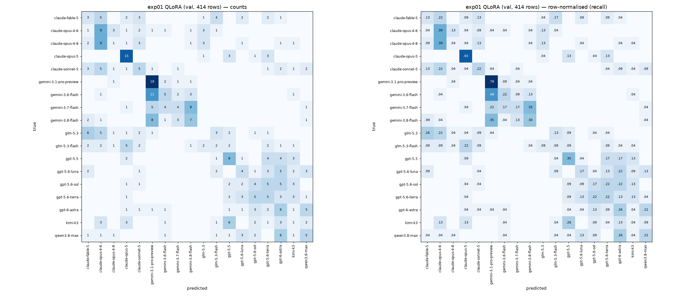
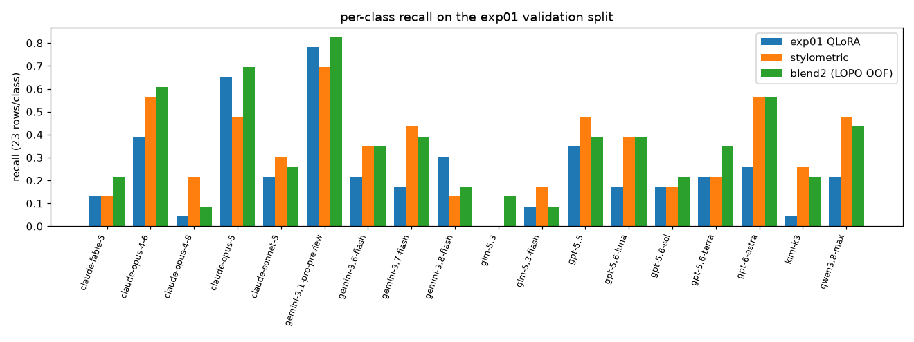

# Experiments

## 2026-11-06 — exp01: Qwen3-8B-Base QLoRA sequence classifier (baseline)

- **Kaggle training run:** [`ritisingh123/rs2027-engs108`](https://www.kaggle.com/code/ritisingh123/rs2027-engs108), version 2. Ran on a single T4 (`CUDA_VISIBLE_DEVICES=0`, `device_map={"": 0}`); the second T4 stayed at 0 MiB used.
- **Environment:** python 3.13, torch 2.11.0+cu130, transformers 5.20.2, peft 0.21.2, accelerate 1.15.0, bitsandbytes 0.50.2.
- **Validation:** `GroupShuffleSplit` on `prompt_id` with `test_size=0.15` and `random_state=42`. This gives 2285 train rows from 127 prompts and 414 validation rows from 23 held-out prompts, i.e. 23 rows per class.
- **Artifacts:**
  - Adapter: Kaggle dataset [`ritisingh123/engs108-qwen3-8b-lora-adapter`](https://www.kaggle.com/datasets/ritisingh123/engs108-qwen3-8b-lora-adapter). It holds the LoRA adapter, the `score` head and `label_map.json`, 15.65 MB in total.
  - bitsandbytes wheel for offline use: [`ritisingh123/engs108-offline-wheels`](https://www.kaggle.com/datasets/ritisingh123/engs108-offline-wheels).

### Hyperparameters

| | |
|---|---|
| Base model | Qwen3-8B-Base, 4-bit NF4, double quant, fp16 compute |
| LoRA | r=8, alpha=16, dropout=0.05, target `q_proj`/`v_proj`, `modules_to_save=["score"]` (3,907,584 trainable params, 0.05%) |
| max_length | 512. Token lengths: p99=316, max=381, so 0 of 2699 texts were truncated |
| Batch | per-device 2 × grad accum 8 = effective 16. A smoke run on the 64 longest texts peaked at 7.5 GB reserved |
| Optimizer | AdamW (Trainer default), lr 1e-4, 3 epochs, 429 steps, fp16, gradient checkpointing (non-reentrant) |
| Selection | eval/save every epoch, `load_best_model_at_end` on `balanced_accuracy`, seed 42 |

### Results (held-out prompt groups)

| Epoch | eval_loss | balanced_accuracy |
|---|---|---|
| 1 | 2.6108 | 0.1304 |
| 2 | 2.3173 | 0.2005 |
| 3 | 2.2104 | **0.2464** (best, loaded) |

Validation balanced accuracy is **0.2464**. Chance level is 1/18 = 0.0556. Plain accuracy is the same (0.2464) because the classes are balanced.

Per-class recall (support 23 each):

| model | recall |
|---|---|
| claude-fable-5 | 0.174 |
| claude-opus-4-6 | 0.391 |
| claude-opus-4-8 | 0.043 |
| claude-opus-5 | 0.652 |
| claude-sonnet-5 | 0.217 |
| gemini-3.1-pro-preview | 0.783 |
| gemini-3.6-flash | 0.217 |
| gemini-3.7-flash | 0.174 |
| gemini-3.8-flash | 0.304 |
| glm-5.3 | 0.000 |
| glm-5.3-flash | 0.087 |
| gpt-5.5 | 0.304 |
| gpt-5.6-luna | 0.174 |
| gpt-5.6-sol | 0.174 |
| gpt-5.6-terra | 0.217 |
| gpt-6-astra | 0.261 |
| kimi-k3 | 0.043 |
| qwen3.8-max | 0.217 |

### Runtime

- Training took 100.1 min (`train_runtime` 6004 s, 1.14 samples/s). The whole notebook took 104.1 min on a T4.
- Peak GPU memory was 6.96 GB allocated and 7.50 GB reserved.

### Observations

- Validation balanced accuracy was still rising at epoch 3 (0.130 → 0.200 → 0.246), so the model probably had not converged.
- The mean training loss over the run is 24.6, far above the validation loss of about 2.2. The smoke run (4 optimizer steps) averaged 147 training loss. By the end of epoch 1, eval loss was 2.61.
  - *Inference, not measured:* the randomly initialised `score` head probably produces very large logits on Qwen3's final hidden states, so the early steps go mostly to rescaling the head.
- No confusion matrix was computed in this run. Which classes get confused with which is not yet measured.

### Offline inference check

- **Kernel:** [`ritisingh123/rs2027-engs108-inference`](https://www.kaggle.com/code/ritisingh123/rs2027-engs108-inference), version 2, with `enable_internet: false`. A request to `https://pypi.org` from inside the session failed with `URLError`.
- **Setup:** bitsandbytes 0.50.2 was installed from the attached wheel dataset using `--no-index`. The adapter was loaded from the attached adapter dataset.
- **Result:** on the same held-out prompt groups, balanced accuracy was 0.2464, identical to the training run. The written `submission.parquet` matches `sample_submission.parquet` (`id: large_string`, `model: large_string`). Its 3 test predictions are identical to the ones the training kernel wrote.
- **Runtime:** 4.7 min total.

## 2026-11-07 — exp02_diagnostics_stylometric: exp01 diagnostics, stylometric baseline, leakage-safe ensemble

No Qwen training was run. The exp01 adapter and `score` head were only loaded in eval mode for inference.

- **Analysis script:** `exp02/exp02_diagnostics_stylometric.py`, a `# %%`-cell script that runs on CPU in about 15 min. It writes `exp02/artifacts/` and `exp02/figures/`. To reproduce:
  ```
  cd exp02 && ENGS108_DATA_DIR=<dir with train.csv> EXP02_HIDDEN_DIR=<dir with pooled_hidden_*.npy> python exp02_diagnostics_stylometric.py
  ```
  Without `EXP02_HIDDEN_DIR` the linear-probe cell is skipped. Get the hidden states with `exp02/fetch_pooled_hidden.sh` (see "Reproducing the probes").
- **Environment (local):** python 3.12, scikit-learn 1.6.1 (the same version as the Kaggle image), numpy 2.2.6, pandas 3.1.1.
- **Split:** the exp01 split recreated exactly: `GroupShuffleSplit(n_splits=1, test_size=0.15, random_state=42)` on `prompt_id`.
  - Train: 2285 rows from 127 prompts; 126 `claude-fable-5` rows and 127 of every other class.
  - Val: 414 rows from 23 prompts, 23 per class.
  - No prompt overlap. The val prompt list equals the one printed in the exp01 log.
- **Persisted exp01 artifacts that exist:**
  - adapter + `score` head + `label_map.json` (Kaggle dataset `ritisingh123/engs108-qwen3-8b-lora-adapter`);
  - the exp01 kernel log;
  - `submission.parquet`.
- **Not persisted by exp01:** `trainer.state.log_history`, per-row val predictions, and the tokenizer (the base model's tokenizer is used unchanged). The per-10-step losses only went to the notebook progress widget, which neither the Kaggle stream log nor the CLI returns. They cannot be recovered without retraining, so the loss curve below uses only the logged epoch evals plus inference-only measurements.

### Qwen inference (inference only, no optimizer, no `trainer.train()`)

| Kernel | What it does | Runtime |
|---|---|---|
| [`ritisingh123/rs2027-engs108-exp02-val-logits`](https://www.kaggle.com/code/ritisingh123/rs2027-engs108-exp02-val-logits) v1 (`exp02/qwen-val-logits/`) | Same code path as the offline inference kernel: `PeftModel.from_pretrained(..., is_trainable=False)`, `model.eval()`, `no_grad`, fp16 autocast, length-sorted batches of 8. Writes the 18 val logits per row → `exp02/artifacts/exp01_val_logits.parquet`. 0 trainable params. Val balanced accuracy **0.2464**, which reproduces exp01. | 2.6 min |
| [`ritisingh123/rs2027-engs108-exp02-val-inference`](https://www.kaggle.com/code/ritisingh123/rs2027-engs108-exp02-val-inference) v2 (`exp02/qwen-val-inference/`) | Step-0 pass: base model + exp01's seed-42 random `score` head, no adapter. This is exactly the function exp01 started from, because LoRA B=0. Then the exp01 adapter pass over all 2699 rows. Writes logits (`step0_logits.parquet`, `exp01_logits.parquet`), `qwen_diagnostics.json`, and the pooled 4096-d hidden states (`pooled_hidden_{step0,exp01}.npy`, 22 MB each, kept in the kernel output and not committed). | 28.3 min |
| [`ritisingh123/rs2027-engs108-exp02-grad-norm`](https://www.kaggle.com/code/ritisingh123/rs2027-engs108-exp02-grad-norm) v1 (`exp02/qwen-grad-norm/`) | Gradient-norm / clipping diagnostic at **`learning_rate=0`**: pre-clip grad norms with and without the GA fix, at exp01's step-0 and trained weights. Weights are asserted unchanged. → `exp02/artifacts/qwen_grad_norm_check.json`. | 11.3 min |

**Batch-padding sensitivity.** These are the same weights and texts; only the batch composition changes. 4-bit/fp16 logits shift by up to 0.027:

| Batching | Val bal-acc | Argmax flips vs primary (of 414) |
|---|---|---|
| Length-sorted (primary; offline inference path) | 0.2464 | — |
| `val_df` order, batches of 8 | 0.2440 | 3 |
| Val interleaved with train rows (kernel v1) | 0.2415 | 2 |

Even the primary logits do not reproduce exp01's per-class recall table exactly. `claude-fable-5` gives 0.130 here against 0.174 in exp01, and `gpt-5.5` gives 0.348 against 0.304. That is one row each, with the same balanced accuracy. exp01's own per-row predictions were not saved, so the last 1–2 rows of disagreement cannot be resolved. All numbers below use the primary logits. Any bal-acc difference under about 0.005 (2 rows) is noise.

### Diagnostics: the 24.6 mean training loss is a logging artifact (8× gradient accumulation)

- **Cause (measured).** In transformers 5.20.2, `Trainer.training_step` divides the logged loss by `gradient_accumulation_steps` only when it believes the model did not already normalise by `num_items_in_batch`. `Qwen3ForSequenceClassification` reports `model_accepts_loss_kwargs=True`, but `GenericForSequenceClassification.forward` calls `self.loss_function(logits=..., labels=..., pooled_logits=..., config=...)` without `**kwargs`. So `num_items_in_batch` is dropped, the loss is a per-micro-batch mean, and the Trainer sums 8 of them without dividing.
  - `exp02/check_grad_accum_loss_logging.py` reproduces this on CPU with a tiny random `Qwen3ForSequenceClassification` at `learning_rate=0`. Logged/true ratios are exactly **1.0 / 8.0 / 4.0** for GA = 1 / 8 / 4 (`exp02/artifacts/grad_accum_loss_check.json`).
- **Effect on optimisation and clipping (measured).** The backward pass uses the same un-divided loss, so gradients are 8× too large. In exp01 that changed almost nothing, because every step was clipped anyway.
  - *Qwen measurement:* kernel [`ritisingh123/rs2027-engs108-exp02-grad-norm`](https://www.kaggle.com/code/ritisingh123/rs2027-engs108-exp02-grad-norm) v1 (`exp02/qwen-grad-norm/`, output `exp02/artifacts/qwen_grad_norm_check.json`).
    - Setup: the exp01 setup (`prepare_model_for_kbit_training`, r=8 q/v, fp16, bs 2 × GA 8, seed 42, `max_grad_norm=1.0`) at **`learning_rate=0`**. All 145 trainable tensors are asserted unchanged afterwards, so this is not training.
    - Runs: 12 optimizer steps on exp01's first train batches, at exp01's step-0 weights and at its trained weights. Each with Trainer defaults (= exp01) and with `trainer.model_accepts_loss_kwargs = False` (the fix).
  - The default/fixed pre-clip grad-norm ratio is **8.0** at both weight states.
  - The true pre-clip grad norm is **250–336 at step 0 and 35–72 at exp01's end state**, i.e. 35–336× above `max_grad_norm=1.0`. **100% of finite steps are clipped with and without the fix.** Clipping rescales the gradient to norm 1, so the 8× factor cancels and the AdamW update is the same.
  - *CPU confirmation* (`exp02/check_grad_accum_optimization.py` → `artifacts/grad_accum_optimization_check.json`): a tiny Qwen3 classifier, AdamW lr 1e-3, 16 steps, with grad norms of about 3 so every step is clipped. Final parameters of the GA=8 default run match the GA=1 reference to a relative L2 of 1e-6, and the fixed runs to 2e-6. With clipping off, the default run drifts by only 1.7e-4, because AdamW is almost scale-invariant (only `eps` sees the scale).
  - **The one real optimisation effect is in the fp16 GradScaler.** The 8× gradients overflow fp16 for 3 more steps (log2 8) while the loss scale calibrates. That is 8 skipped optimizer steps instead of 5, at both weight states, i.e. about 3 of exp01's 429 steps were lost. Skipped steps don't advance the LR schedule.
  - **Head gradients dominate the clipped norm.** The `score` head's gradient norm is about **100× the LoRA matrices'** at step 0 and about **10×** at the end. *Inference:* clipping at 1.0 is dominated by the head's gradient, which is consistent with exp01's head and LoRA being driven mostly by AdamW's per-parameter normalisation at lr 1e-4.
  - **Fix for exp03:** set `trainer.model_accepts_loss_kwargs = False` after constructing the `Trainer`, so the Trainer divides by GA. This gives a correct logged loss, a true `grad_norm`, and no extra GradScaler skips, with no change to the clipped update. An alternative is `compute_loss_func` returning summed CE / `num_items_in_batch`; both match the GA=1 reference on CPU.
- **Check against the smoke run.** The smoke run logged 147. Divided by 8 that is 18.38, and the measured step-0 CE on the same 64 longest train texts is **18.40**.
- **Corrected exp01 mean training loss:** 24.645 / 8 = **3.08**.

| Quantity | Value | Source |
|---|---|---|
| step-0 CE, train / val (random `score` head) | 17.63 / 17.71 | inference |
| step-0 val bal-acc | 0.0556 (= chance) | inference |
| uniform-prediction CE ln(18) | 2.89 | — |
| exp01 mean logged train loss / 8 | 3.08 | exp01 log ÷ GA |
| eval loss, epochs 1 / 2 / 3 | 2.611 / 2.317 / 2.210 | exp01 log |
| end-of-training CE, train-split / val (eval mode) | 1.825 / 2.211 | inference |
| end-of-training train-split bal-acc | 0.382 | inference |

- **Random-head burn-in is real but explains only a smaller part.**
  - The seed-42 random head (std 0.020, the `initializer_range`) applied to pooled hidden states with norm ≈ 318 gives logits with per-row std ≈ 7.1. Step-0 CE is therefore 17.6, against 2.89 for uniform predictions. Ten other random heads with the same std give 7.0–13.6.
  - *Inference, not measured:* if the epoch-2/3 train loss was at most the epoch-1 eval loss (2.61), the epoch-1 mean train loss was at least 4.0. So the first epoch includes a large-loss burn-in from the random head. Once the 8× factor is removed, the overall mean of 3.08 is unremarkable.
- **The `score` head barely moved.**
  - cosine(W0, W1) = 0.994, and its Frobenius norm went from 5.42 to 5.44.
  - The per-row logit std still fell from 7.1 to 1.9, while the median pooled hidden-state norm fell only from 318 to 255. *Inference, not measured:* with the head nearly fixed, most of that logit rescaling must come from the LoRA'd backbone rotating the pooled states away from W0's rows, i.e. the backbone adapted to the head rather than the head being learned.
- **The trained head is underfit relative to its own features (linear probes).**
  - Setup: logistic regression on the saved pooled hidden states, fit on train rows only, with C chosen by `GroupKFold(5)` on train prompts and scored once on val.

  | Features | C | Train grouped-CV bal-acc | Val bal-acc | Val macro F1 |
  |---|---|---|---|---|
  | Base Qwen3-8B, step 0 (no adapter) | 0.01 | 0.319 | 0.329 | 0.321 |
  | exp01 LoRA model | 0.001 | 0.417* | **0.377** | 0.364 |
  | *(exp01 `score` head itself)* | — | — | 0.246 | 0.224 |

  \*Optimistic: the LoRA saw these train rows.
  - The same exp01 features carry a linear signal worth 0.377 val bal-acc, but exp01's head extracts 0.246.
  - Even the frozen base model's features with a fitted linear head (0.329) beat exp01.
- **Reproducing the probes.**
  - The pooled hidden states (`pooled_hidden_{step0,exp01}.npy`: 2699 × 4096 float16, 22 MB each) are not committed. Their sha256 sums are in `exp02/artifacts/pooled_hidden_SHA256SUMS`.
  - Row order = `exp02/artifacts/exp01_logits.parquet`, i.e. exp01's `train_df` rows then `val_df` rows. The script maps rows by `id`.
  - **Retrieve:** `exp02/fetch_pooled_hidden.sh [dest]` downloads the private Kaggle dataset [`ritisingh123/engs108-exp02-pooled-hidden-states`](https://www.kaggle.com/datasets/ritisingh123/engs108-exp02-pooled-hidden-states) and runs `sha256sum -c`. It needs Kaggle CLI auth with access to that dataset.
  - **Regenerate:** `kaggle kernels push -p exp02/qwen-val-inference`, then `kaggle kernels output ritisingh123/rs2027-engs108-exp02-val-inference -p <dest>`. That is about 28 min on a T4, inference only. Regenerated 4-bit/fp16 states may not be bit-identical, so run the script with `EXP02_ALLOW_HIDDEN_MISMATCH=1`.
  - **Run:** `EXP02_HIDDEN_DIR=<dest> python exp02_diagnostics_stylometric.py`. The script refuses to run on a checksum mismatch unless that flag is set, and records `pooled_hidden_sha256_match` in `exp02_results.json`.
  - Probe val probabilities are committed: `exp02/artifacts/linear_probe_{step0,exp01}_val_proba.csv`.
  - Verified: the fetch → checksum → rerun path reproduces the probe numbers above, and the rest of `exp02_results.json` is unchanged apart from timings.

### Diagnostics: exp01 class confusions



- **Summary:** val bal-acc 0.2464, macro F1 0.2245. Family accuracy is 0.604 (predicted the right vendor: claude / gemini / glm / gpt / kimi / qwen).
- **Errors are mostly within-family:** 9 of the top 12 confusion cells are same-family.
- **Largest cells:**
  - `gemini-3.6-flash` → `gemini-3.1-pro-preview` (11/23);
  - `claude-opus-4-8` → `claude-opus-4-6` (9);
  - `gemini-3.8-flash` → `gemini-3.1-pro-preview` (8);
  - `gemini-3.7-flash` → `gemini-3.8-flash` (8).
- **Cross-family:** `kimi-k3` → `gpt-5.5` (6), `glm-5.3` → `claude-fable-5` (6), `qwen3.8-max` → `gpt-6-astra` (6).
- **Over-predicted classes act as attractors:** `gemini-3.1-pro-preview` is predicted 46 times (precision 0.39), `claude-opus-4-6` 41 times, `gpt-6-astra` 37 times.
- **Recall ≤ 0.09:** `glm-5.3` (0.00), `claude-opus-4-8` (0.04), `kimi-k3` (0.04), `glm-5.3-flash` (0.09).
- **Full tables:** per-class precision/recall/F1/support are in `exp02/artifacts/exp02_results.json` under `exp01.per_class`. The row-normalised matrix is the right panel of the figure.

### Classical stylometric baseline (same split)

- **Features:**
  - required char TF-IDF: `TfidfVectorizer(analyzer="char_wb", ngram_range=(3, 5), min_df=2, sublinear_tf=True)`;
  - optional word TF-IDF: `analyzer="word"`, `(1, 2)`, `min_df=2`, `sublinear_tf=True`;
  - 27 standardised style features: log length, word count, mean word length, sentence count and length, type-token ratio, and per-character rates of punctuation, uppercase, digits, whitespace, newlines, 13 specific punctuation marks (`,` `;` `:` dashes, quotes, parentheses, `!` `?` ellipsis), and markdown `*`/`#`.
- **Classifiers:** multinomial `LogisticRegression` (primary); `CalibratedClassifierCV(LinearSVC, cv=3, method="sigmoid")` for comparison.
- **Model selection:** every vectorizer and classifier is fit on train rows only. Selection uses grouped 5-fold CV on train prompts. Val is scored once per variant and never used for selection.

| Variant | Train grouped-CV bal-acc | Val bal-acc | Val macro F1 |
|---|---|---|---|
| char, LR C=1 | 0.268 | 0.290 | 0.271 |
| char, LR C=10 | 0.278 | 0.295 | 0.285 |
| char, LR C=100 | 0.272 | 0.300 | 0.292 |
| char+word+style, LR C=1 | 0.324 | 0.302 | 0.277 |
| char+word+style, LR C=10 | 0.346 | 0.336 | 0.316 |
| **char+word+style, LR C=100** (primary: best train-CV) | **0.351** | **0.336** | **0.316** |
| char+word+style, cal. LinearSVC C=0.1 | 0.318 | 0.304 | 0.270 |
| char+word+style, cal. LinearSVC C=0.5 | 0.330 | 0.329 | 0.294 |

- Even the char-only spec baseline (0.290–0.300) beats exp01 (0.246).
- Primary stylometric model: macro F1 0.316, family accuracy 0.669.
- Its errors are again mostly within-family (gemini flash versions, glm-5.3 ↔ glm-5.3-flash, gpt-5.6-sol → luna). It recovers some classes exp01 almost never gets: `kimi-k3` 0.26, `gpt-6-astra` 0.57, `qwen3.8-max` 0.48.
- Val probabilities: `exp02/artifacts/stylometric_val_proba.csv`. Confusion matrix: `exp02/figures/confusion_stylometric.png`.

### Complementarity and leakage-safe ensemble

- **Raw complementarity:**
  - QLoRA and stylometric agree on only 27% of val rows; error correlation is 0.22;
  - both correct: 12.8%;
  - only QLoRA correct: 11.8%;
  - only stylometric correct: 20.8%;
  - oracle "either correct": 45.4%.
- **Ensembles,** all on val log-probabilities:
  - `equal`: log p_q + log p_s, nothing fitted;
  - `blend2`: a·log p_q + b·log p_s with a, b ≥ 0 fitted by NLL. This is the primary ensemble and has 2 parameters;
  - `stacker`: multinomial LR on the 36 concatenated log-probs.
- **Leakage controls:**
  - the stylometric model never sees val;
  - ensemble weights are never fit on the rows they are scored on.
  - Protocol 1, val-A/val-B: `GroupShuffleSplit(test_size=0.5, random_state=42)` on val `prompt_id` gives val-A = 198 rows / 11 prompts and val-B = 216 rows / 12 prompts, with no shared prompt. Fit on A, report on B; the reverse direction is reported as a sensitivity check.
  - Protocol 2, leave-one-prompt-out cross-fitting: for each of the 23 val prompts, fit on the other 22 and predict the held-out one. This gives honest out-of-fold (OOF) predictions for all 414 rows.
  - The bootstrap CIs resample whole val prompts (2000 draws).

| Protocol 1 (bal-acc) | Report rows | QLoRA | Stylometric | equal | blend2 (a, b) | stacker |
|---|---|---|---|---|---|---|
| Fit A → report B | 216 | 0.236 | 0.329 | 0.375 | 0.357 (0.60, 0.21) | 0.338 |
| Fit B → report A | 198 | 0.258 | 0.343 | 0.369 | 0.369 (0.58, 0.42) | 0.258 |

| Protocol 2, LOPO OOF on all 414 val rows | Bal-acc | Macro F1 | Family acc |
|---|---|---|---|
| exp01 QLoRA alone | 0.246 | 0.224 | 0.604 |
| Stylometric alone | 0.336 | 0.316 | 0.669 |
| equal (no fitted params) | **0.372** | **0.354** | 0.727 |
| blend2 (a = 0.60 ± 0.01, b = 0.29 ± 0.03 across folds) | 0.355 | 0.337 | 0.710 |
| stacker (36 → 18 LR) | 0.283 | 0.286 | 0.621 |

Paired differences in val bal-acc, with 95% CIs from the prompt-grouped bootstrap:

| Difference | Δ | 95% CI |
|---|---|---|
| Stylometric − QLoRA | +0.089 | [+0.041, +0.140] |
| blend2 − QLoRA | +0.109 | [+0.068, +0.150] |
| equal − QLoRA | +0.126 | [+0.072, +0.179] |
| blend2 − stylometric | +0.019 | [−0.024, +0.063], P(Δ ≤ 0) = 0.21 |
| stacker − QLoRA | +0.036 | [−0.002, +0.077] |

- **The two models are complementary.** Both simple blends beat each component on the held-out side of both protocols.
- **Most of the gain over QLoRA comes from the stylometric model.** The blend's gain over stylometric alone (+0.02) is not significant on 23 val prompts.
- **The 36-feature stacker overfits** the ~400 val rows and should not be used.
- **Caveat:** `equal` was not pre-specified as primary, and choosing it after seeing these numbers would be a mild selection effect.

**Equal log-probability blend: the exact method (for inference).** It is implemented in `exp02/blend.py` as `equal_logprob_blend(qlora_logits, stylo_proba)`, which the analysis script uses.

```
z_c   = log_softmax(qlora_logits)_c + log(clip(stylo_proba_c, 1e-12, 1))   # weights fixed at (1, 1), nothing fitted
p_c   = softmax(z)_c                                                        # normalised product of the two distributions
label = argmax_c z_c                                                        # ties -> lowest class id
```

- **QLoRA input:** raw `score` logits from the exp01 adapter, computed as in the offline inference notebook (eval mode, fp16 autocast, `max_length=512`, length-sorted batches of 8). No temperature.
- **Stylometric input:** `predict_proba` of the primary pipeline `char+word+style | lr | C=100`, fit on the exp01 train split (2285 rows). It combines char_wb 3–5 TF-IDF, word 1–2 TF-IDF and the standardised style features, with `LogisticRegression(C=100, max_iter=3000)`. This is the configuration evaluated here.
  - Refitting it on all 2699 rows for a submission is a reasonable but **unvalidated** change.
- **Column order:** column c of both inputs is class id c from the adapter's `label_map.json` (= `sorted(model names)`). The script asserts `stylo.classes_ == range(18)`.
- **Batching caveat:** 4-bit/fp16 logits shift slightly with batch padding (see above), so use the same batching to reproduce exactly.

**Classes corrected or worsened by blend2 (LOPO OOF) vs exp01 QLoRA.** Counts are val rows out of 23 per class.

| Class | QLoRA recall | blend2 recall | Corrected | Worsened |
|---|---|---|---|---|
| gpt-6-astra | 0.261 | 0.565 | 7 | 0 |
| qwen3.8-max | 0.217 | 0.435 | 6 | 1 |
| gpt-5.6-luna | 0.174 | 0.391 | 6 | 1 |
| gemini-3.7-flash | 0.174 | 0.391 | 6 | 1 |
| claude-opus-4-6 | 0.391 | 0.609 | 5 | 0 |
| kimi-k3 | 0.043 | 0.217 | 5 | 1 |
| glm-5.3 | 0.000 | 0.130 | 3 | 0 |
| gpt-5.6-terra | 0.217 | 0.348 | 3 | 0 |
| gemini-3.6-flash | 0.217 | 0.348 | 4 | 1 |
| claude-fable-5 | 0.130 | 0.217 | 3 | 1 |
| gpt-5.5, gpt-5.6-sol, claude-sonnet-5, claude-opus-5, claude-opus-4-8, gemini-3.1-pro-preview | — | — | +1 net each | |
| glm-5.3-flash | 0.087 | 0.087 | 0 | 0 |
| **gemini-3.8-flash** | 0.304 | 0.174 | 1 | **4** |

- Against stylometric alone, blend2 mainly helps `claude-opus-5` (+5 net), `gemini-3.1-pro-preview`, `glm-5.3` and `gpt-5.6-terra` (+3 each).
- It mainly hurts `claude-opus-4-8` (−3), `glm-5.3-flash` and `gpt-5.5` (−2 each).
- The blend's remaining errors are still dominated by within-family confusion: `gpt-5.6-sol` → `luna` (9), gemini flash versions (7–8), `claude-opus-4-8` → `sonnet-5` (6).
- Figures: `exp02/figures/confusion_blend2_oof.png` and `exp02/figures/per_class_recall.png`.



### Recommendation for the next expensive run

**Run a longer QLoRA convergence run with a properly trained head. Do not run a LoRA-capacity ablation yet.**

- **exp01 is underfit, and not capacity-limited at its current operating point.**
  - Train-split CE 1.82 and train bal-acc 0.38 are far from fitting the training set.
  - Val bal-acc and val loss were still improving at epoch 3.
  - The `score` head stayed within cosine 0.994 of its random initialisation.
  - A linear probe on exp01's own pooled features gets 0.377 val bal-acc against the head's 0.246. The current r=8 `q_proj`/`v_proj` features already carry more signal than the head extracts.
  - A capacity ablation (higher r, more target modules) would be confounded by this head under-training. Its result would not be interpretable until the r=8 model is near convergence.
- **Suggested changes for that run.** These are suggestions for the next PR; none were run here.
  - Give the `score` head its own higher learning rate (about 10–100× the LoRA LR), or initialise it from the linear probe on the base model's pooled features (linear-probe-then-finetune).
  - Train for more epochs, keeping `load_best_model_at_end`.
  - Persist `trainer.state.log_history` and per-row val logits.
  - Fix the GA loss scaling with `trainer.model_accepts_loss_kwargs = False` (see the clipping section above). This fixes logging and the GradScaler skips; it does not change the clipped update.
- **Bar for the next run.** It should beat the stylometric baseline (0.336) and ideally the blend (about 0.36), or it adds nothing over a CPU model. If the converged r=8 model still trails its linear probe, or plateaus with train CE well above val CE, that is the point to run the capacity ablation.

**Untested or limitations:**
- 23 val prompts give wide CIs: ±0.04–0.05 on bal-acc differences.
- exp01's exact per-row predictions could not be recovered (see batch sensitivity above).
- The per-step training-loss curve is unrecoverable without retraining.
